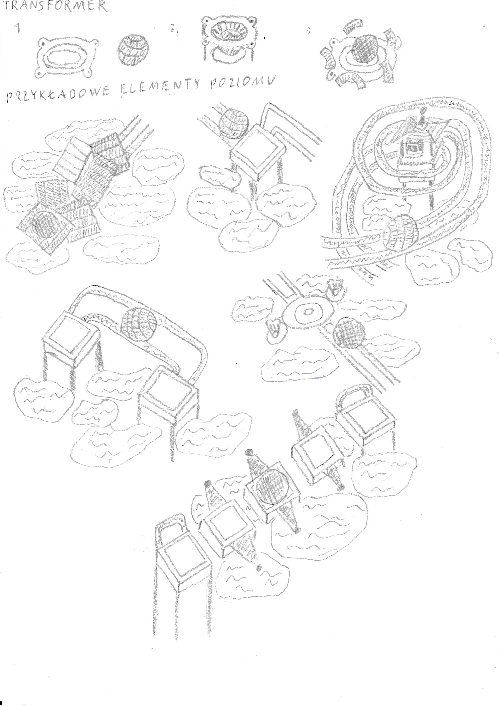

**Grafika i gry komputerowe**

**GDD**

Wykonane przez:

Artur Piwowarczyk

Dawid Pawlica

Łukasz Skrzypek

1. Fabuła – opis historii prezentowanej przez grę. W zależności od typu rozbudowana (RPG) lub prosta (zręcznościowa)

Brak głębszej historii zawartej w grze, gracz ma za zadanie przejść poziomy.

2. Postacie – wprowadza avatarów i NPC, którzy będą obecni w grze

Jedna postać, którą steruje gracz – kula tocząca się od początku do końca poziomu. Brak NPC.

3. Projekt poziomu/środowiska – projekt świata w jakim będzie realizowana gra.

Każdy poziom rozgrywa się na betonowych platformach umieszczonych w powietrzu. Poszczególne platformy są połączone drewnianymi mostami bądź metalowymi prowadnicami, a część z nich jest niepołączona żadną ciągłą ścieżką i wymaga sprawnego poruszania się po mniejszych platformach wyspach.

4. Rozgrywka – w jaki sposób realizowana będzie rozgrywka

Gracz do dyspozycji będzie miał określoną ilość poziomów. Poziomy powinny stopniowo wprowadzać kolejne mechaniki, by zaznajomić z nimi gracza, a dalsze poziomy powinny łączyć wiele mechanik razem w ramach jednej “zagadki”. Po przejściu danego poziomu gracz będzie oceniany punktowo – im szybciej gracz go przejdzie, tym więcej punktów otrzyma. Na wynik będzie też wpływać liczba pozostałych żyć.

5. Sztuka – jakie elementy graficzne będą wykorzystane, w jakim stylu 

Styl graficzny gry za pomocą prostej grafiki trójwymiarowej odwzorowuje wygląd obiektów zbliżony do rzeczywistości - platformy teksturą betonu, mosty – drewna, prowadnice – metalu typu aluminium. Skybox będący teksturą nieba - zależnie od poziomu w różnym porach dnia.

6. Dźwięk i muzyka – opis strony dźwiękowej gry

Menu będzie zawierało inną muzykę niż w rozgrywce. Podczas rozgrywki będzie towarzyszyć muzyka zmieniana co nowy poziom. Gatunek muzyki powinien być ambientowy – mający spokojny nastrój, tak by nie rozpraszać gracza, ale też nie tworzyć w nim poczucia wybrakowania.

Dodatkowe dźwięki:

- Toczenie się kuli (zmienne dla danej powierzchni),

- Zmiana w transformatorze,

- Obijanie się o i ruch po prowadnicy,

- Popchnięcie przedmiotów (pudła, kule, itd.)

- Zdobycie punktów życia i czasu

- Utrata punktów życia

- Interfejs menu

7. Interfejs użytkownika, sterowanie grą – sposób prowadzenia rozgrywki

Gracz steruje kulą za pomocą przycisków poruszania w czterech kierunkach. Interakcja z obiektami polega na ich dotknięciu bądź przepchaniu – brak dedykowanego przycisku interakcji. Kamera umieszczona jest zawsze pod tym samym kątem, ale gracz ma możliwość zmiany jej kierunku patrzenia, tak by móc wybrać dogodny widok bądź spojrzeć na tor z nieco innej perspektywy. W trakcie poziomu kula będzie zmieniać materiał, z którego jest wykonana poprzez interakcje z transformatorami.

8. Sposób dystrybucji – w jakich kanałach prowadzona będzie sprzedaż/ promocja

- Twitter/X - promocja gry, zwiastuny, stworzenie społeczności

- Steam – promocja gry, zwiastuny

- YouTube – promocja gry, zwiastuny

- Strona internetowa – promocja gry, zwiastuny

9. Model finansowania – w jakim wymiarze rozwiązanie będzie finansowane.

Powód:

- Wynajęcie osoby do stworzenia obiektów

- Kupno grafiki na kulkę

- Licencja na Unity na wypadek przekroczenie progu pobrań

Źródła pozyskania środków:

- Sponsorzy

- YouTube

- Dofinansowania

Szkice:

